<div align="center">

#  MediSphere AI

### AI-powered healthcare assistant for clinics: symptom guidance, doctor discovery, appointment booking, voice and image chat, medical-document understanding, and screening ML, all in one platform.


**Hinglish-first · Voice-enabled · RAG-grounded · RBAC-protected · Safety-aware**

</div>

>  **Medical disclaimer:** MediSphere AI provides *general health information only*. It is **not** a doctor, does **not** diagnose, prescribe medicines, or calculate doses. In an emergency call **112 / 108** immediately.


##  Table of Contents

1. [Overview](#-overview)
2. [Key Features](#-key-features)
3. [System Architecture](#-system-architecture)
4. [Technology Stack](#-technology-stack)
5. [Project Structure](#-project-structure)
6. [End-to-End Flows](#-end-to-end-flows)
   - [6.1 Application startup](#61-application-startup-flow)
   - [6.2 Login and session](#62-login--session-flow)
   - [6.3 Text chat (master flow)](#63-text-chat-master-flow)
   - [6.4 Suggestion engine (RAG + MCP)](#64-suggestion-engine-rag--mcp-flow)
   - [6.5 Doctor discovery and appointment booking](#65-doctor-discovery--appointment-booking-flow)
   - [6.6 Voice chat](#66-voice-chat-flow)
   - [6.7 Injury photo analysis](#67-injury-photo-analysis-flow)
   - [6.8 MCP agent and tool calling](#68-mcp-agent--tool-calling-flow)
   - [6.9 Clinic assistant RAG pipeline](#69-clinic-assistant-rag-pipeline)
   - [6.10 COVID screening ML](#610-covid-screening-ml-flow)
   - [6.11 Pretrained NLP Studio](#611-pretrained-nlp-studio-flow)
   - [6.12 MedLens AI](#612-medlens-ai-flow)
   - [6.13 Admin and System dashboards](#613-admin--system-dashboards)
7. [Safety and Guardrails](#-safety--guardrails)
8. [Database Design](#-database-design)
9. [API Reference](#-api-reference)
10. [MCP Tools and RBAC Matrix](#-mcp-tools--rbac-matrix)
11. [Configuration](#-configuration)
12. [Installation and Setup](#-installation--setup)
13. [Running the Project](#-running-the-project)
14. [Testing](#-testing)
15. [Security Notes](#-security-notes)
16. [Known Issues and Roadmap](#-known-issues--roadmap)


##  Overview

**MediSphere AI** (branded in the UI as *Sanjeevani AI Clinic*) is a full-stack, AI-first clinic assistant. A patient can describe symptoms by **typing, speaking, or uploading an injury photo**; the system responds with safe, knowledge-base-grounded precautions, recommends the right **medical specialty**, lists matching **doctors with live free slots**, and completes the **appointment booking** conversationally, all in simple **Hinglish**.

Around this core, the repository bundles five additional modules that share the same backend:

| Module | Purpose |
|---|---|
| **AI Chatbot** | Text, voice and image driven triage, doctor suggestion and booking |
| **Medical MCP Server** | FastMCP tool server exposing clinic data and the suggestion engine with role-based access |
| **Clinic RAG** | FAISS-based retrieval over a curated clinic knowledge base |
| **COVID Screening ML** | scikit-learn pipeline that predicts COVID likelihood from intake data |
| **Pretrained NLP Studio** | POS tagging, NER, sentiment/urgency hint and word-embedding similarity |
| **MedLens AI** | OCR + LangGraph + ChromaDB assistant that explains prescriptions and lab reports |

### Why this project?

- Patients often do not know *which* specialist to see or what to do *right now*.
- Reception desks lose time on repetitive questions and slot coordination.
- Many users prefer **Hindi/Hinglish and voice** over English forms.
- Medical content must be **grounded and safe**, not free-form LLM guesses.

MediSphere AI addresses these with a **suggestion-first, retrieval-grounded** design: advice comes from the clinic's own knowledge base, and the LLM is only used to rephrase or orchestrate tools, never as the source of medical truth.


##  Key Features

###  Conversational triage and booking
- **Symptom → specialty routing** for 14+ specialties using a rule engine that understands **English, Roman Hindi and Devanagari**.
- **RAG-grounded precautions** (observation, 3 immediate precautions, urgent warning signs) with sources.
- **Doctor list with live free slots**, five daily slots computed against the database.
- **State-machine booking flow**: pick doctor → pick slot → confirm → booked (with slot-collision protection) and **cancel at any time**.
- **Patient-history aware**: last diagnosis and doctor are injected as context.
- **Per-user rate limiting** (15 requests/minute on chat endpoints).

###  Voice assistant (Sarvam AI)
- Auto-detects Hindi / English / Hinglish speech (`saarika:v2.5`).
- Spoken replies via `bulbul:v2` with a **short, listenable** version of the on-screen answer.
- **Streaming NDJSON response**: text appears instantly, audio chunks follow as they are synthesised in parallel.
- Browser-side **silence detection**, 16 kHz mono WAV capture, pre-roll so the first word is never clipped.
- **Canonicalisation layer** converts spoken Devanagari/Hinglish ("हाँ", "दस बजे", "डॉक्टर रोहन") into the exact tokens the booking flow understands.

###  Injury image analysis (Gemini)
- Upload a photo → description, **severity** (Minor / Moderate / Severe), **body part** and **specialty** (Orthopedic / Dermatologist / General OPD).
- Then reuses the same suggestion engine and doctor/slot flow as text and voice.

###  MCP-powered agent
- **FastMCP** server with **12 tools** and **4 roles** (`User`, `Admin`, `Super Admin`, `System`).
- Groq LLM performs native tool calling; every tool enforces RBAC.
- Strict anti-hallucination system prompt ("answer only from tool output").

###  Retrieval-Augmented Generation
- Markdown knowledge base → chunking → TF-IDF vectors → **FAISS (cosine/IP)** → top-k retrieval → grounded answer.
- Emergency and self-harm detection with immediate escalation messaging.
- Optional, **guarded web search** (SerpAPI) only for "latest / news / outbreak / advisory" style medical queries.
- In-memory cache (TTL 10 min) and automatic fallback if the MCP server is unreachable.

###  MedLens AI (mounted at `/medlens/`)
- Upload PDF / PNG / JPG / WEBP / BMP / TIFF.
- Native PDF text extraction, automatic **Tesseract OCR** fallback for scans.
- Classifies **prescription vs lab report**, extracts medicine lines and numeric lab values.
- **LangGraph** workflow with age-gating and medicine-confirmation safety steps.
- **ChromaDB + Sentence-Transformers (`all-MiniLM-L6-v2`)** retrieval over safety knowledge.
- Optional Gemini summarisation via LangChain, with deterministic fallback when disabled.

###  Classical ML + NLP
- Modular, production-style **training pipeline** (ingestion → transformation → trainer) with automatic best-model selection.
- **NLP Studio**: NLTK POS/NER, VADER sentiment with an **urgency hint**, GloVe word similarity.

###  Platform
- JWT utilities, RBAC dependency, Google OAuth wiring, SlowAPI rate limiting.
- Central logging and a custom exception class with file/line context.
- Every text / image / voice message is persisted with **latency breakdown** (STT, chat, TTS).


##  System Architecture

### High-level design

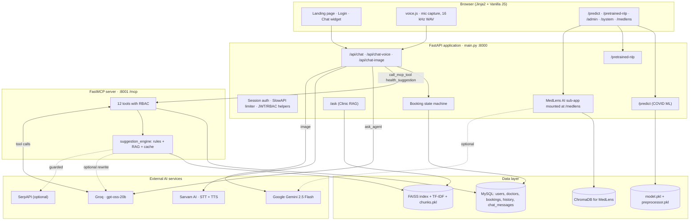

### Design principles

| Principle | How it is implemented |
|---|---|
| **Suggestion-first** | Symptom/appointment intents are answered from the RAG suggestion tool *before* any free-form LLM call. |
| **Graceful degradation** | If the MCP suggestion tool times out (6 s), the legacy rule-based flow runs unchanged. Chat logging errors never break a reply. |
| **Grounded generation** | The LLM only rewrites retrieved text (3 s timeout) or orchestrates tools; the system prompt forbids invented facts. |
| **One brain, three channels** | Text, voice and image share the same decision logic; only input (STT/Vision) and output (TTS) differ. |
| **Least privilege** | Every MCP tool checks the caller's role before executing. |


##  Technology Stack

| Layer | Technologies |
|---|---|
| **Language / Runtime** | Python 3.12, `uv` (lockfile) or `pip` |
| **Web framework** | FastAPI, Uvicorn, Starlette sessions, Jinja2, `python-multipart` |
| **Auth and protection** | `python-jose` (JWT), `passlib[bcrypt]`, `authlib` (Google OAuth), `slowapi` (rate limit), `itsdangerous` |
| **Database** | MySQL via SQLAlchemy 2.x ORM + PyMySQL |
| **LLM orchestration** | Groq SDK (`openai/gpt-oss-20b`), **FastMCP** (tool server + client), LangChain, **LangGraph** |
| **Vision / multimodal** | Google Gemini 2.5 Flash (`google-generativeai`, `langchain-google-genai`) |
| **Speech** | Sarvam AI (`saarika:v2.5` STT, `bulbul:v2` TTS), `httpx` async client |
| **Retrieval** | scikit-learn TF-IDF + **FAISS** (clinic RAG), **ChromaDB** + Sentence-Transformers (MedLens) |
| **OCR / documents** | Tesseract (`pytesseract`), PyMuPDF, Pillow |
| **Classical ML** | pandas, NumPy, scikit-learn (Logistic Regression, Decision Tree, Random Forest, KNN) |
| **NLP** | NLTK (POS, NER, VADER), Gensim (GloVe `glove-wiki-gigaword-50`) |
| **Frontend** | HTML5, CSS, vanilla JavaScript (Web Audio API for voice capture) |
| **Search (optional)** | SerpAPI |
| **Testing** | pytest, httpx |


##  Project Structure

```text
MediSphere-AI/
├── main.py                      # FastAPI entrypoint: routes, booking state machine, voice/image endpoints
├── user_handle.py               # Rate limiter, JWT create/verify, RBAC dependency, Google OAuth config
├── pyproject.toml               # Project metadata and dependencies (uv)
├── requirements.txt             # pip-style dependency list
├── uv.lock                      # Locked dependency graph
├── .env.example                 # All supported environment variables
├── install_windows.bat          # Windows venv bootstrap
├── run_windows.bat              # Windows run helper
├── notes.ipynb                  # Design notes: HLD diagram, library explanations
│
├── chatbot/                     # Conversational backend
│   ├── database/
│   │   ├── db_config.py         # SQLAlchemy engine, SessionLocal, get_db()
│   │   ├── models.py            # ORM models + init_db()
│   │   └── insert_dummy_data.py # Seeds 40 doctors, demo user and history
│   ├── llm_helper.py            # analyze_and_respond(): agent call + specialty detection fallback
│   ├── suggestion_client.py     # Bridge to MCP `health_suggestion` + HTML builders
│   ├── doctor_suggestion.py     # DB lookup of doctors by specialty
│   ├── injury_analyzer.py       # Gemini vision analysis of injury photos
│   ├── voice_handler.py         # Sarvam STT/TTS, transcript canonicalisation, TTS chunking
│   ├── history_handler.py       # Patient history summary for LLM context
│   └── chat_log.py              # Persists text/image/voice messages with timings
│
├── medical_mcp/                 # MCP tool server and agent
│   ├── mcp_server.py            # FastMCP server (:8001): 12 RBAC-protected tools
│   ├── ai_agent.py              # Groq tool-calling agent + direct call_mcp_tool()
│   ├── suggestion_engine.py     # Rule engine, RAG retrieval, LLM rewrite, cache, SerpAPI guard
│   ├── database.py              # MCP-side DB helpers + initial seed data
│   ├── main.py                  # Standalone FastAPI wrapper for the agent (optional)
│   └── clinic.db                # Local SQLite file used by the module
│
├── rag/                         # Clinic knowledge-base RAG
│   ├── config/rag_config.yaml   # Chunking, retrieval, generation settings
│   ├── knowledge_base/          # 5 curated Markdown documents
│   ├── document_loader.py       # Load + paragraph-aware chunking with overlap
│   ├── vector_store.py          # TF-IDF + FAISS IndexFlatIP build/load
│   ├── retriever.py             # Similarity search with min-score filter
│   ├── generator.py             # Groq grounded answer generation
│   ├── rag_pipeline.py          # Retrieve → generate → sources
│   └── rag_config_loader.py     # YAML loader
│
├── src/                         # Classical ML pipeline (COVID screening)
│   ├── components/
│   │   ├── data_ingestion.py    # Read CSV, stratified 80/20 split
│   │   ├── data_transformation.py # ColumnTransformer: impute, ordinal, one-hot
│   │   └── model_trainer.py     # Train 4 models, keep the best
│   ├── pipeline/
│   │   ├── train_pipeline.py    # End-to-end training entry
│   │   └── predict_pipeline.py  # CustomData + PredictPipeline (inference)
│   ├── utils.py                 # save/load pickle, evaluate_models
│   ├── logger.py                # Timestamped file + console logging
│   └── exception.py             # CustomException with file/line detail
│
├── nlp_pretrained/              # NLP Studio backend
│   ├── ner_tagger.py            # POS tags + PERSON / GPE / ORGANIZATION
│   ├── sentiment_analyzer.py    # VADER sentiment + urgency hint
│   ├── embedding.py             # GloVe most-similar words
│   └── download_nltk_data.py    # One-time NLTK resource downloader
│
├── MedLens_AI/                  # Mounted at /medlens (also runnable standalone)
│   ├── app/
│   │   ├── main.py              # FastAPI sub-app: /api/analyze, /api/chat, /api/health, /api/logs/latest
│   │   ├── graph/workflow.py    # LangGraph: classify → summarize → context → retrieve → answer
│   │   ├── services/            # ocr_service, document_service, rag_service, llm_service
│   │   └── core/                # config (pydantic-settings), logger, exceptions
│   ├── knowledge_base/          # Medicine-safety and report-explanation basics
│   ├── static/                  # Frontend (HTML/CSS/JS)
│   └── tests/                   # API and document-service tests
│
├── artifacts/                   # Generated/trained artifacts
│   ├── model.pkl, preprocessor.pkl          # COVID model + preprocessing
│   ├── faiss.index, vectorizer.pkl, chunks.pkl # RAG index
│   └── raw.csv, train.csv, test.csv         # Dataset splits
│
├── templates/                   # Jinja2: index, predict, pretrained_nlp, admin, system
└── static/                      # style.css, voice.js
```


##  End-to-End Flows

### 6.1 Application startup flow

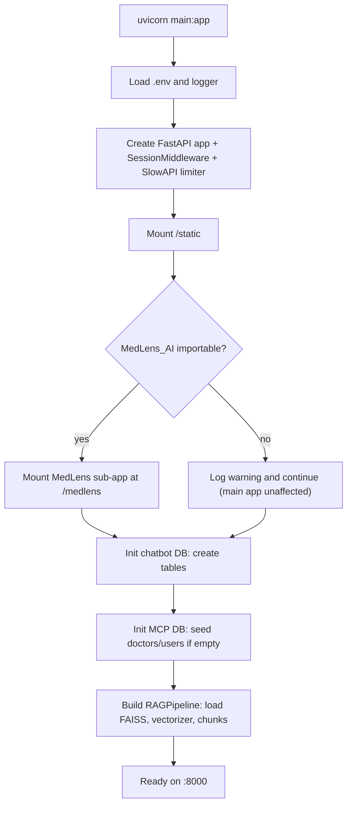

> The MCP server (`:8001`) is a **separate process** and must be running for the suggestion and agent features. If it is not, the chatbot automatically falls back to its rule-based flow.


### 6.2 Login & session flow

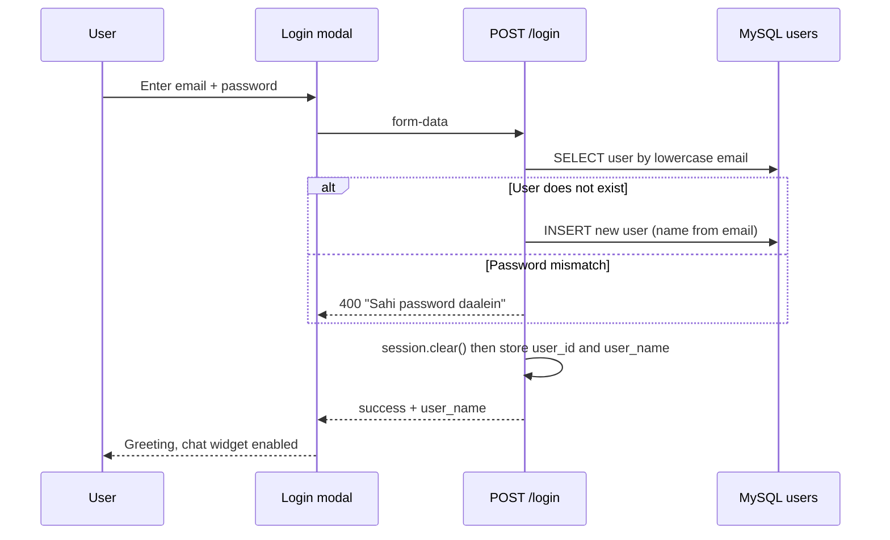

- Session data (signed cookie) holds: `user_id`, `user_name`, `history_context`, `recent_chat` (last 600 chars), `pending_booking`, `suggested_specialty`, `suggested_doctors`, `booked`.
- `GET /logout` clears the session.
- JWT + RBAC helpers (`create_access_token`, `require_role`) and **Google OAuth** (`/auth/google`, `/auth/google/callback`) are provided for protected admin APIs.


### 6.3 Text chat (master flow)

`POST /api/chat` is the central decision engine. Voice and image channels funnel into the same logic.

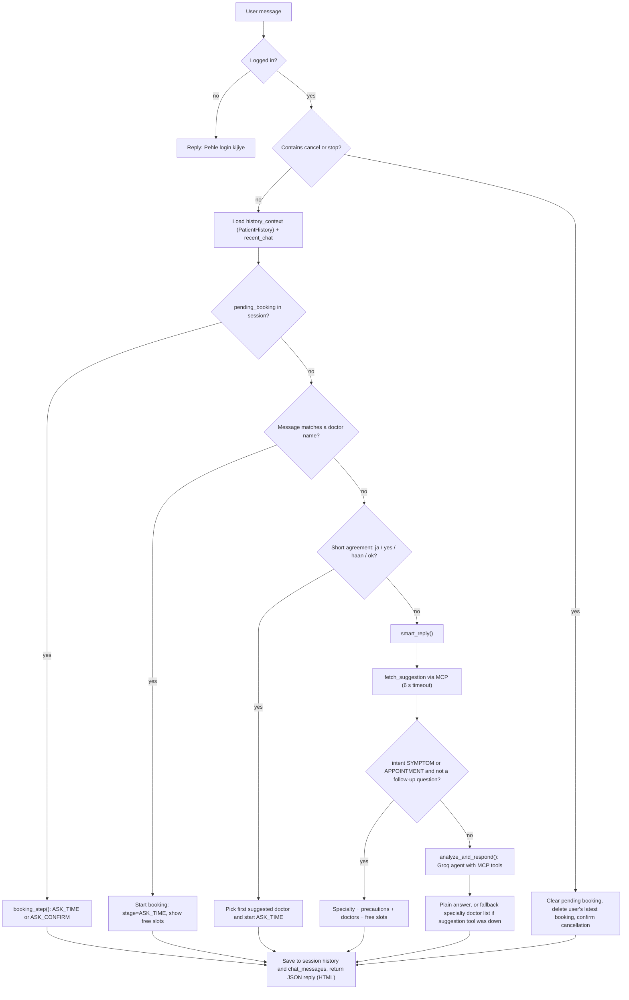

**Follow-up handling:** if the user already received doctors for a specialty and then asks a *question* about the same complaint, the bot answers the question instead of re-listing doctors.


### 6.4 Suggestion engine (RAG + MCP) flow

Exposed as the MCP tool `health_suggestion`, used by text, voice **and** image channels.

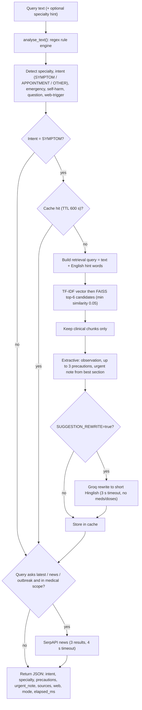

**Response `mode` values:** `rag-extractive`, `rag-llm`, `+cache`, `+web`, `none`.

**Specialties detected:** Pediatrician, Gynecologist, Cardiologist, Neurologist, Pulmonologist, Gastroenterologist, Orthopedic, Dermatologist, ENT Specialist, Ophthalmologist, Psychiatrist, Urologist, Endocrinologist, with **General OPD** as the default.

**Languages handled:** English, Roman Hindi/Hinglish (e.g., *sir dard, pet dard, khansi, kamar dard*) and Devanagari (e.g., *सिरदर्द, खांसी, पेट दर्द*).


### 6.5 Doctor discovery & appointment booking flow

Fixed daily slots: `10:00 AM · 11:30 AM · 02:00 PM · 04:30 PM · 06:00 PM`. Free slots are computed by subtracting today's rows in `bookings` for that doctor.

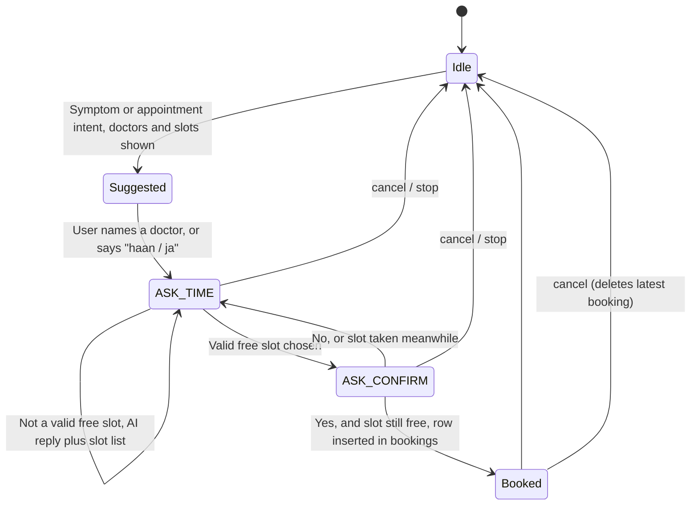

Highlights:

- **Slot matching** is forgiving: `10`, `10am`, `10:00`, `10:00am` all resolve to `10:00 AM`.
- **Double-booking guard:** the slot is re-validated right before insert.
- **Confirmation words:** `yes, haan, ha, ok, okay, confirm, book kardo`; **decline words:** `no, nahi, na`.
- **Confirmation message** includes doctor name, slot and date.


### 6.6 Voice chat flow

`POST /api/chat-voice` (rate-limited) turns speech into the same booking/triage brain and streams the answer back.

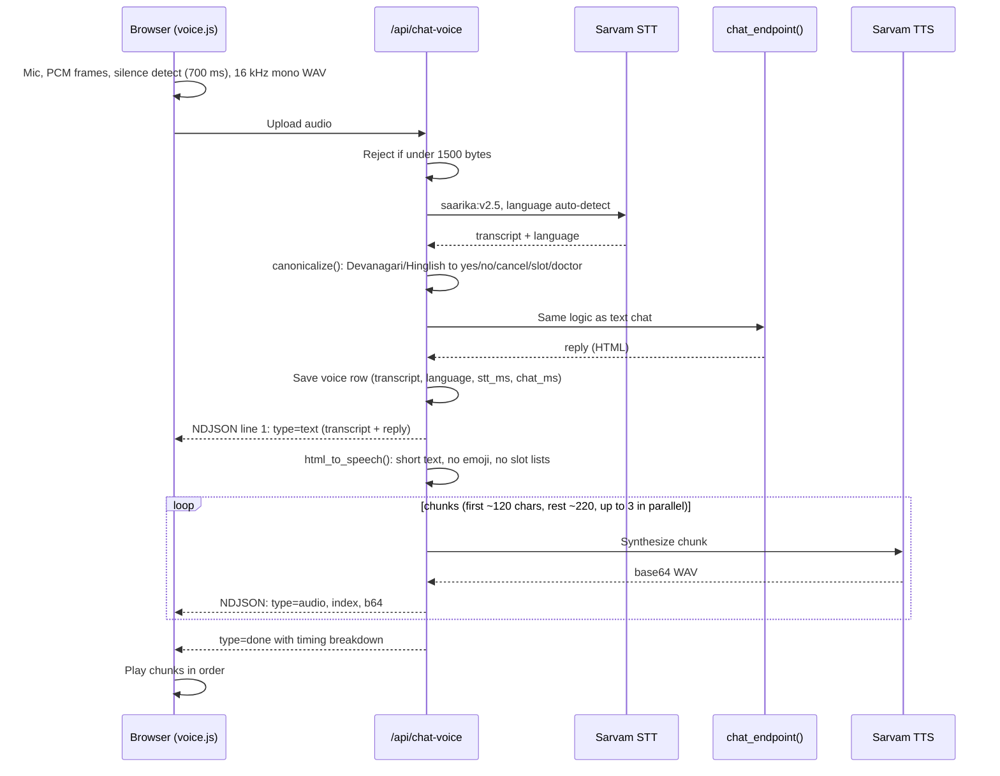

**Latency engineering**

- Shared keep-alive `httpx` client (no repeated TLS handshakes).
- Spoken reply limited to `VOICE_MAX_CHARS` (default 450).
- Small first TTS chunk so audio starts early; remaining chunks are synthesised in parallel (`VOICE_TTS_PARALLEL=3`) but delivered in order.
- Yes / no / cancel / time / doctor turns **never touch an LLM**.
- Timings (`stt_ms`, `chat_ms`, `tts_ms`, `total_ms`) are stored per message.

**UX controls:** click mic to start; it auto-stops after silence; click again while listening to send immediately, or while the bot speaks to stop playback. Max recording 15 s.


### 6.7 Injury photo analysis flow

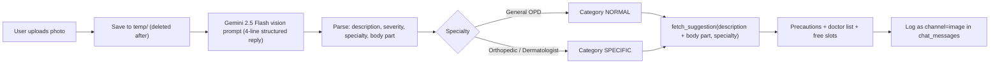

Severity is normalised to `Minor | Moderate | Severe`. Specialty is restricted to `Orthopedic`, `Dermatologist` or `General OPD` for predictable routing.


### 6.8 MCP agent & tool-calling flow

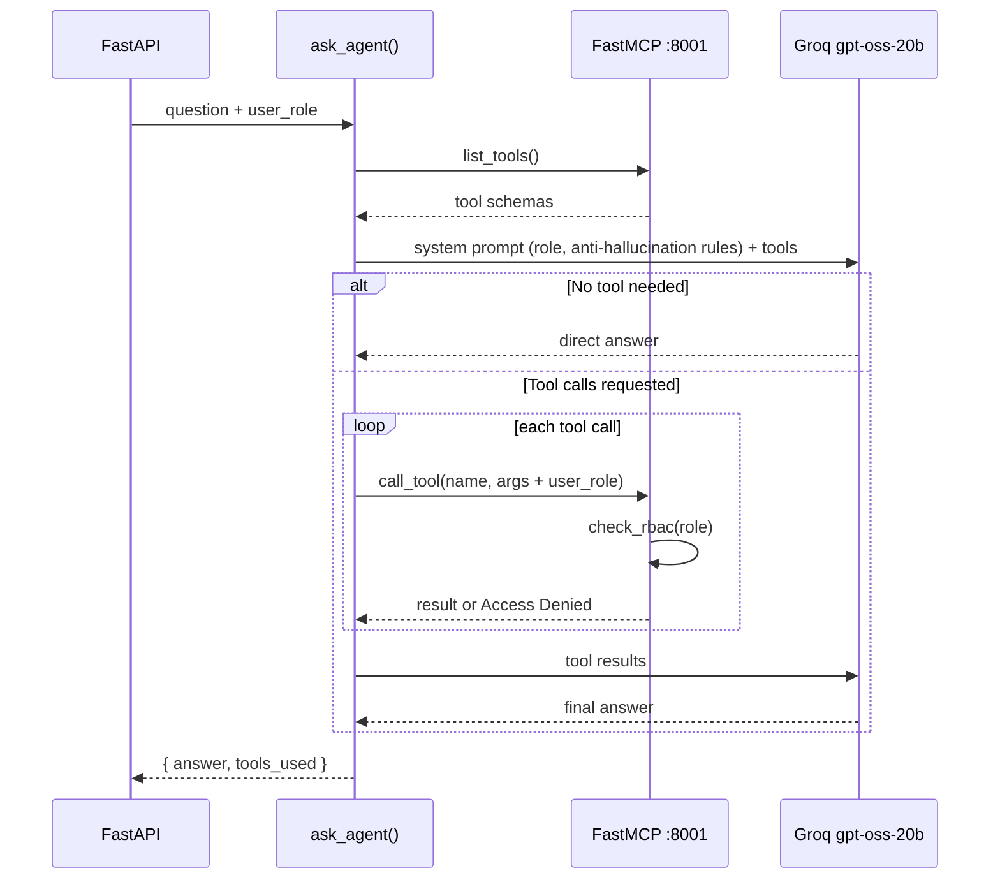

**Agent rules enforced in the system prompt**

1. Symptoms → 1-line observation, 2-3 precautions, recommended specialty, then `list_doctors`.
2. If the user already picked a doctor or time → **do not call tools**.
3. Use *only* tool/database data; otherwise say *"Requested data is not available in the database."*
4. Respect RBAC errors and tell the user clearly.
5. Medical information questions → `health_suggestion` only.
6. `web_search` only for latest/current medical or project information, and disclose it is from the internet.
7. Keep answers to 3-4 sentences (many users listen via voice).


### 6.9 Clinic assistant RAG pipeline

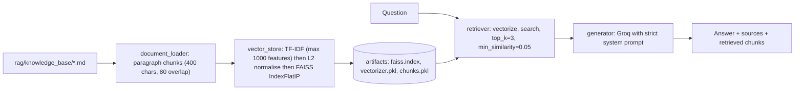

**Knowledge base**

| File | Content |
|---|---|
| `hospital_rag_chatbot_knowledge_base.md` | Safety policy, specialty routing guide for 25 areas, response templates |
| `home_care_guidance.md` | Safe home-care measures |
| `isolation_guidelines.md` | Isolation guidance |
| `testing_and_recovery.md` | Testing and recovery information |
| `when_to_see_doctor.md` | Red flags and escalation |

**Generator constraints** (`rag_config.yaml`): answer only from context; never name medicines or doses; 3-5 sentences; cite the topic; end with a "general information, not a diagnosis" reminder; reply in the patient's language where practical.

> Rebuild the index automatically: if the three artifact files are missing, the suggestion engine rebuilds them from `rag/knowledge_base/` on first use.


### 6.10 COVID screening ML flow

**Training** (`python -m src.pipeline.train_pipeline`)

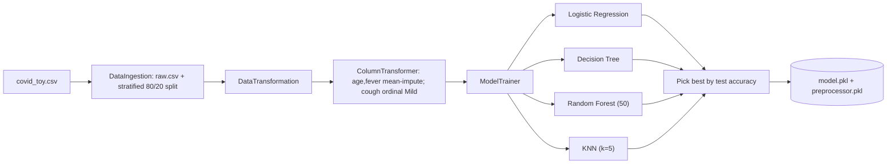

**Inference** (`/predict`)

1. User fills **age, gender, fever (°F), cough (Mild/Strong), city**.
2. `CustomData` builds a one-row DataFrame.
3. `PredictPipeline` loads `preprocessor.pkl` and `model.pkl`, transforms, predicts.
4. Returns **Positive / Negative** plus a **confidence %** (`max(predict_proba) × 100`) when the model supports it.

> This is a *screening demo* trained on a small toy dataset; it is not a diagnostic tool.


### 6.11 Pretrained NLP Studio flow

`POST /pretrained-nlp` runs four analyses on a user sentence:

| Analysis | Library | Output |
|---|---|---|
| **POS tagging** | NLTK | `(word, tag)` list |
| **Named-entity recognition** | NLTK `ne_chunk` | `PERSON`, `GPE`, `ORGANIZATION` |
| **Sentiment** | NLTK VADER | pos/neg/neu/compound + **urgency hint** (`High` ≤ -0.5, `Medium` ≤ -0.15, else `Low`) |
| **Word similarity** | Gensim GloVe-50 | Top-5 words similar to the first word |

Run `python nlp_pretrained/download_nltk_data.py` once before first use.


### 6.12 MedLens AI flow

Available at **`/medlens/`** (mounted) or standalone from `MedLens_AI/`.

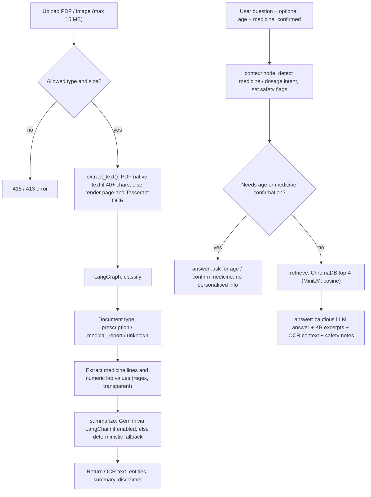

**Safety gates built into the graph**

- **Age missing** → age-dependent medicine/dose guidance is withheld.
- **Medicine unconfirmed** → the user must confirm the medicine name and strength first (OCR can misread).
- Never prescribes, calculates, or adjusts doses; unreadable instructions are never guessed.

**MedLens API:** `GET /api/health` · `POST /api/analyze` · `POST /api/chat` · `GET /api/logs/latest`


### 6.13 Admin & System dashboards

| Page | Route | Purpose |
|---|---|---|
| **Admin** | `/admin` | Admin login, summary stats, generate **system credentials** for monitoring accounts |
| **System** | `/system` | MCP status, DB status, LLM status, active connections, **audit log** table |

Related endpoints: `POST /api/admin/login`, `POST /api/admin/generate-system-credentials`, `POST /api/system/login`, `GET /api/system/metrics`, `GET /api/system/audit-logs`, `GET /api/admin/dashboard` (JWT + `Admin` role).

> These dashboards are currently **demo-grade** (mock tokens, in-memory users and logs). See [Security Notes](#-security-notes).


##  Safety & Guardrails

| Guardrail | Behaviour |
|---|---|
| **Emergency detection** | Patterns such as heart attack, stroke, unconsciousness, cannot breathe, severe bleeding, seizure, poisoning, chest pain with breathlessness/sweating (English + Hinglish + Devanagari) trigger a banner: *call 112 / 108 or go to emergency, do not wait for an appointment.* |
| **Self-harm detection** | Shows a compassionate message with **112** and **Tele-MANAS 14416**. |
| **No medicines or doses** | RAG generator, rewrite prompt and MedLens all forbid medicine names/dosages. |
| **No diagnosis** | Responses are framed as "general observation" with a "not a diagnosis" reminder. |
| **Grounding** | Advice is retrieved from the clinic KB; the agent must say *"data not available"* instead of guessing. |
| **Scope-limited web search** | Internet queries run only for medical / clinic / project-related text. |
| **HTML escaping** | LLM text is escaped before rendering to prevent injection. |
| **Fail-safe logging** | Chat-log failures are swallowed so patient replies are never blocked. |

---

##  Database Design

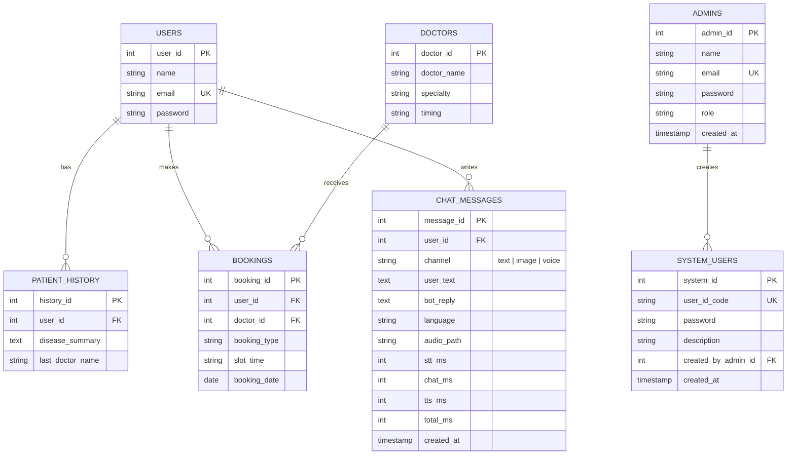

Tables are created automatically on startup (`Base.metadata.create_all`).


##  API Reference

### Pages (HTML)

| Method | Route | Description |
|---|---|---|
| GET | `/` | Landing page with login/register and chat widget |
| GET/POST | `/predict` | COVID screening form and result |
| GET/POST | `/pretrained-nlp` | NLP Studio |
| GET | `/admin`, `/admin.html` | Admin dashboard |
| GET | `/system`, `/system.html` | System dashboard |
| GET | `/medlens/` | MedLens AI UI |
| GET | `/logout` | Clear session and redirect home |

### Chat and AI

| Method | Route | Auth | Body | Description |
|---|---|---|---|---|
| POST | `/login` | none | form: `email`, `password` | Login (auto-registers new emails) |
| POST | `/api/chat` | session, 15/min | form: `user_message` | Master text chat |
| POST | `/api/chat-voice` | session, 15/min | multipart: `audio` | Voice chat; **NDJSON stream** (`text`, `audio`, `audio_error`, `done`) |
| POST | `/api/chat-image` | session | multipart: `injury_image` | Injury photo triage |
| POST | `/api/suggest-doctor` | none | form: `symptom` | Doctors by specialty |
| POST | `/book-appointment` | none | JSON: `patient_name, specialty, doctor_details, slot` | Booking confirmation stub |
| POST | `/chat`, `/api/mcp-chat` | none | JSON: `message`, `role` | Direct MCP agent chat |
| GET/POST | `/ask` | none | form: `question` | Clinic RAG assistant |
| GET | `/health` | none | | Liveness check |

### Auth and admin

| Method | Route | Description |
|---|---|---|
| POST | `/api/login-demo` | Issue a demo JWT (`username`, `role`) |
| GET | `/api/admin/dashboard` | JWT + `Admin` (or `Super Admin`) |
| GET | `/auth/google`, `/auth/google/callback` | Google OAuth login |
| POST | `/api/admin/login` | Admin sign-in (demo) |
| POST | `/api/admin/generate-system-credentials` | Create system user (demo, in-memory) |
| POST | `/api/system/login` | System sign-in (demo) |
| GET | `/api/system/metrics` | Service status snapshot |
| GET | `/api/system/audit-logs` | Audit entries |

### Example: chat request

```bash
curl -X POST http://localhost:8000/api/chat \
  -H "Cookie: session=<your-session-cookie>" \
  -F "user_message=Mujhe pet me bahut dard ho raha hai"
```

```json
{
  "status": "success",
  "reply": "General info: ... <br><b>Immediate Precautions:</b><br>1. ... <br>Aapko <b>Gastroenterologist</b> specialist ko dikhana chahiye. Yeh doctors available hain:<br><br><b>1. Dr. Mehta</b> ..."
}
```

### Example: voice stream (NDJSON)

```json
{"type":"text","status":"success","transcript":"...","reply":"...","language":"hi-IN"}
{"type":"audio","index":0,"mime":"audio/wav","b64":"UklGR..."}
{"type":"done","timing":{"stt_ms":0,"chat_ms":0,"tts_first_ms":0,"total_to_first_audio_ms":0}}
```


##  Configuration

Copy `.env.example` to `.env` and fill in values.

### Core

| Variable | Description | Default / Example |
|---|---|---|
| `DB_HOST` | MySQL host | `localhost` |
| `DB_USER` | MySQL user | `root` |
| `DB_PASSWORD` | MySQL password (required) | *(set your own)* |
| `DB_NAME` | Database name | `health_chatbot_db` |
| `GROQ_API_KEY` | Groq key for agent, rewrite and RAG generation | required |
| `GROQ_MODEL` | Groq model | `openai/gpt-oss-20b` |
| `GEMINI_API_KEY` | Gemini key (injury photos, MedLens summaries) | required for those features |
| `MCP_SERVER_URL` | MCP endpoint used by the app | `http://127.0.0.1:8001/mcp` |

### Voice (Sarvam)

| Variable | Description | Default |
|---|---|---|
| `SARVAM_API_KEY` | Sarvam subscription key | required for voice |
| `SARVAM_STT_MODEL` | Speech-to-text model | `saarika:v2.5` |
| `SARVAM_STT_LANG` | Language (`unknown` = auto) | `unknown` |
| `SARVAM_TTS_MODEL` | Text-to-speech model | `bulbul:v2` |
| `SARVAM_TTS_SPEAKER` | Voice | `anushka` |
| `SARVAM_TTS_LANG` | Default TTS language | `hi-IN` |
| `SARVAM_TTS_PACE`, `SARVAM_TTS_SAMPLE_RATE` | Optional tuning | unset |
| `VOICE_MAX_CHARS` | Max characters spoken | `450` |
| `VOICE_FIRST_CHUNK_CHARS` / `VOICE_TTS_CHUNK_CHARS` | First / later TTS chunk size | `120` / `220` |
| `VOICE_TTS_PARALLEL` | Parallel TTS requests | `3` |
| `SAVE_VOICE_AUDIO` | Store user audio in `voice_data/` | `false` |

### Suggestion engine

| Variable | Description | Default |
|---|---|---|
| `SUGGESTION_REWRITE` | `false` = skip LLM, return raw RAG text (fastest) | `true` |
| `SUGGEST_MODEL` | Small/fast model for rewrite | `GROQ_MODEL` |
| `SUGGESTION_CANDIDATES` | Chunks fetched from FAISS | `6` |
| `SUGGESTION_CONTEXT_CHARS` | Context chars sent to LLM | `900` |
| `SUGGESTION_LLM_TIMEOUT` | Rewrite timeout (s) | `3.0` |
| `SUGGESTION_TOOL_TIMEOUT` | MCP call timeout (s) | `6` |
| `SUGGESTION_CACHE_TTL` | Cache lifetime (s) | `600` |
| `SERPAPI_API_KEY` | Enables web search (optional) | unset |
| `SERPAPI_TIMEOUT` | Web search timeout (s) | `4.0` |

### MedLens AI

| Variable | Description | Default |
|---|---|---|
| `TESSERACT_CMD` | Path to Tesseract executable | auto-detect |
| `ENABLE_LLM` | Use Gemini for summaries | `false` in code |
| `GEMINI_MODEL` | Gemini model | `gemini-2.0-flash` in code |
| `MAX_UPLOAD_MB` | Upload limit | `15` |
| `CHROMA_PATH`, `UPLOAD_DIR`, `KB_DIR` | Data/uploads/knowledge paths | `./data/chroma`, `./uploads`, `./knowledge_base` |
| `LOG_LEVEL` | Log verbosity | `INFO` |

---

##  Installation & Setup

### Prerequisites

- **Python 3.12+**
- **MySQL 8+** running locally or remotely
- **Tesseract OCR** (only for MedLens scanned documents)
  - Windows: install from the official Tesseract distribution and set `TESSERACT_CMD`
  - Linux: `sudo apt install tesseract-ocr`
  - macOS: `brew install tesseract`
- API keys: **Groq**, **Gemini**, **Sarvam** (SerpAPI optional)

### 1. Clone

```bash
git clone https://github.com/krishkydv77/MediSphere-AI.git
cd MediSphere-AI
```

### 2. Create an environment and install dependencies

**Option A: `uv` (recommended, uses `uv.lock`)**

```bash
pip install uv
uv sync
source .venv/bin/activate        # Windows: .venv\Scripts\activate
```

**Option B: `pip`**

```bash
python -m venv .venv
source .venv/bin/activate        # Windows: .venv\Scripts\activate
pip install --upgrade pip
pip install -r requirements.txt
```

### 3. Configure environment

```bash
cp .env.example .env             # Windows: copy .env.example .env
# edit .env and add your keys and DB credentials
```

### 4. Prepare MySQL

```sql
CREATE DATABASE health_chatbot_db CHARACTER SET utf8mb4;
```

Create tables, then seed the 40 demo doctors:

```bash
python -m chatbot.database.models
python -m chatbot.database.insert_dummy_data
```

> Seed **before** the first app start. On startup, the MCP module inserts a small default doctor list only if the `doctors` table is empty.

### 5. Download NLTK resources (for NLP Studio)

```bash
python nlp_pretrained/download_nltk_data.py
```

### 6. (Optional) Retrain the COVID model

Pre-trained artifacts are already in `artifacts/`. To retrain, place the dataset at `notebook/data/covid_toy.csv` and run:

```bash
python -m src.pipeline.train_pipeline
```

### 7. (Optional) Rebuild the RAG index

Delete `artifacts/faiss.index`, `artifacts/vectorizer.pkl` and `artifacts/chunks.pkl`; they are rebuilt from `rag/knowledge_base/` on next use. After editing knowledge files, rebuild to apply changes.

---

## ▶️ Running the Project

Use **two terminals** from the project root.

**Terminal 1: MCP tool server (port 8001)**

```bash
python -m medical_mcp.mcp_server
```

**Terminal 2: Main application (port 8000)**

```bash
uvicorn main:app --reload --host 0.0.0.0 --port 8000
# python -m uvicorn main:app --reload --port 8000
# or: python main.py
```

| URL | What you get |
|---|---|
| http://localhost:8000/ | Landing page + AI chat (text / voice / image) |
| http://localhost:8000/predict | COVID screening |
| http://localhost:8000/pretrained-nlp | NLP Studio |
| http://localhost:8000/medlens/ | MedLens AI |
| http://localhost:8000/admin | Admin dashboard |
| http://localhost:8000/system | System dashboard |
| http://localhost:8000/docs | Interactive Swagger docs |

**Run MedLens standalone**

```bash
cd MedLens_AI
uvicorn app.main:app --reload       # http://127.0.0.1:8000
```

### Quick demo script

1. Open `/`, register/login with any email.
2. Open the chat widget and type: **"Mujhe pet me dard hai"** → precautions + Gastroenterologists + free slots.
3. Reply with a doctor name, e.g. **"Dr. Mehta"** → choose **"10:00 AM"** → say **"yes"** → booking confirmed.
4. Type **"cancel"** → booking removed.
5. Click the **🎤 mic** and say *"mujhe sir dard hai"* → hear the spoken answer.
6. Click the **📎 image** icon and upload an injury photo.
7. Visit `/medlens/` and upload a prescription or lab report.

---

##  Testing

```bash
# MedLens API and document-service tests
cd MedLens_AI && pytest -q

# Module smoke tests (run from project root)
python -m rag.rag_pipeline            # sample RAG question
python -m chatbot.history_handler     # patient history lookup
python -m chatbot.database.db_config  # DB connectivity check
python -m src.logger                  # logger test
```

Unit tests validate plumbing, not OCR accuracy, LLM medical correctness, or clinical safety. Use sample files with **no personal data**.


##  Security Notes

This repository is a **learning / prototype build**. Before any real-world or public deployment, address the following:

| Area | Current state | Recommended action |
|---|---|---|
| **Secrets** | JWT secret and session secret are hard-coded in source; OAuth client values are placeholders | Move all secrets to environment variables; rotate any value ever committed |
| **Passwords** | User passwords are stored and compared as **plaintext** | Hash with `passlib[bcrypt]` (already a dependency) |
| **Registration** | `/login` silently creates an account for unknown emails | Add explicit register + email verification |
| **Admin / System auth** | Demo credentials and **mock tokens** in code; system users stored in memory | Use the `admins` / `system_users` tables with hashed passwords and real JWTs; protect all `/api/admin/*` and `/api/system/*` routes with `require_role` |
| **RBAC input** | `/chat` and `/api/mcp-chat` accept `role` from the request body | Derive the role from the verified JWT, never from client input |
| **Default DB password** | `.env.example` ships a sample password | Replace with a strong unique password |
| **PHI / privacy** | Chat logs, transcripts and optional voice audio are stored | Add consent, retention limits, encryption at rest, and access auditing (HIPAA/DPDP-style requirements) |
| **Uploads** | Uploaded MedLens files and a local `clinic.db` exist in the repo tree | Add them to `.gitignore`; never commit patient data |
| **Transport** | HTTP by default | Terminate TLS in front of the app; set secure cookie flags |


### Roadmap

- [ ] Real auth: hashed passwords, JWT everywhere, refresh tokens, Google sign-in completion
- [ ] Multi-day appointment calendar with reschedule and reminders (SMS / WhatsApp / email)
- [ ] Replace TF-IDF with dense embeddings (e.g., MiniLM) and hybrid search in the clinic RAG
- [ ] Doctor portal: manage availability, view patient history and upcoming bookings
- [ ] Real metrics and audit logging persisted to the database
- [ ] Multilingual expansion beyond Hindi/English (Tamil, Bengali, Marathi, etc.)
- [ ] Prescription-to-reminder workflow from MedLens extractions
- [ ] Docker + `docker-compose` (app, MCP, MySQL) and CI with automated tests
- [ ] Observability: structured logs, tracing, latency dashboards
- [ ] Clinical review of the knowledge base by licensed medical professionals


##  Author

· [@krishkydv77](https://github.com/krishkydv77)
·LinkedIn krishan-kumar7

If this project helps you, please consider giving it a ⭐ on GitHub.


<div align="center">

**Built with  for accessible, safe and multilingual healthcare.**

*This software is for educational and demonstration purposes and does not replace professional medical advice.*

</div>
